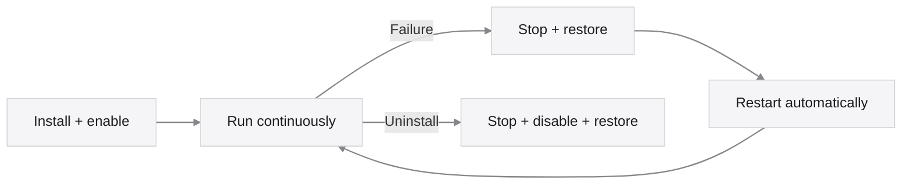
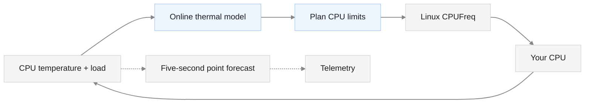

<h1 align="center">Lerwatt</h1>

<p align="center">AI-powered CPU power management. Built for your Linux.</p>

## Results at a glance

**54.47% lower five-second temperature-forecast error: 1.47°C → 0.67°C MAE.**
The real daemon achieved this equal-profile average against its previous
reference forecaster in **six 20-minute simulated-board runs**. Random and sparse
loads tied the reference; the largest gains came from recurring patterns.
[Forecast results and raw records →](results/point-model-observations/runtime/README.md)

**2.7°C cooler and 81% fewer ceiling changes in one simulated burst case.**
The optional joint MPC also served less work. This 900-second bare-board
scenario compares joint MPC with Lerwatt's rule baseline:

| Metric | Rule baseline | Joint MPC |
| --- | ---: | ---: |
| Peak temperature after 300 s | 82.2°C | **79.5°C** |
| Mean modeled board power | 6.64 W | **6.54 W** |
| Frequency-ceiling changes | 42 | **8** |
| Share of demanded work served | **66.43%** | 65.56% |

The cooler result costs **0.87 percentage points of served work**. Other cases
also lose: joint MPC served 73.56% versus rule's 79.25% under passive-cooled load
steps. **Joint planning is opt-in.** Fresh managed-service installations default
to independent MPC with rule fallback. These are descriptive simulator cases, not hardware
averages or confidence intervals.
[All control comparisons and adverse cases →](docs/SIMULATION.md#4-control-and-forecast-results)

**Physical power savings, battery life and application throughput remain
unmeasured.** The original `nominal` prediction path keeps point forecasts separate from CPU
limits. An experimental cooperative predictor can tighten five-second MPC
decisions within a validated action context. Standalone installs keep nominal
MPC by default; cooperative prediction is selected independently with
`--prediction cooperative`. Compatible running peers are discovered automatically. Enabled does not mean every correction is applied, nor that Lertick
improves accuracy. Small finite-job regressions remain recorded. [Implementation and limits](docs/COOPERATIVE_PREDICTION.md). A separate 192-run simulator-module study reduced mean forecast MAE by
28.95–29.51%, with a small worst-profile regression; it uses a different dataset.
[Module results →](results/point-model-observations/README.md)

<p align="center">
  <a href="#get-started-on-ubuntu">Get started →</a> &nbsp;&nbsp;
  <a href="#how-it-works">Explore Lerwatt →</a> &nbsp;&nbsp;
  <a href="docs/USAGE.md">Read the guide →</a>
</p>

<p align="center">
  
</p>

<p align="center">
  <strong>Learns your machine.</strong> Builds a thermal model while it runs.<br />
  <strong>Plans ahead.</strong> Uses that model to choose predictive CPU ceilings.<br />
  <strong>Runs around the clock.</strong> Starts at boot. Restarts after failures. Uninstall to remove.
</p>

<p align="center">
  <a href="https://github.com/Denny-Lin/lerwatt/actions"></a>
  <a href="LICENSE"></a>
  
</p>

<br />

## Get started on Ubuntu

**Ubuntu 22.04 / 24.04 · systemd · sudo access · no reboot**

Use a normal user account. The helper builds locally and asks for sudo when needed.

**1. Prepare and check**

```sh
sudo apt-get update
sudo apt-get install --no-install-recommends git build-essential ca-certificates
git clone https://github.com/Denny-Lin/lerwatt.git
cd lerwatt
./deploy.sh check
```

**2. Install and start continuous control**

```sh
./deploy.sh install
```

Installation enables `lerwatt.service` at boot and starts it immediately. There is no five-minute limit: the service keeps running, including after reboot, until you stop or uninstall it. The installer reports active competing policy services instead of disabling them automatically.

**3. See how it is doing**

```sh
lerwatt status
lerwatt logs
```

An independent systemd watchdog supervises progress. A stalled worker is stopped, its settings are restored where possible, and the service restarts. Missing sensors pause control through the same recovery path.



To remove Lerwatt and stop automatic startup:

```sh
lerwatt uninstall
```

Uninstall stops and disables the service, restores journaled settings, then removes the managed tools and unit. Recovery failures preserve the recovery tools and journal for repair.

Want a trial first? `./deploy.sh preview --duration 60` leaves control settings unchanged; `./deploy.sh run --duration 300` runs a finite foreground trial before installing the service. `install-tools` keeps a tools-only option for other init systems. [Service, configuration and recovery →](docs/SERVICE.md)

## How it works



The thermal model learns online; rule control covers warm-up and fallback. The service saves compatible learned thermal parameters every five minutes and on normal shutdown, then reuses them after restart. Fresh learning usually needs at least about 90 seconds of suitable observations. A preview does not pretrain the service; control history and unfinished forecasts are always refreshed.

Linux continues handling frequency transitions, idle-state selection and thermal protection. Learned planning sets CPU frequency ceilings; frequency floors and PM QoS idle-latency constraints currently use rules. The five-second point forecast is reported in telemetry; cooperative mode can also use supported, reliable predictions in MPC decisions. [Architecture and expansion →](docs/DESIGN.md)

## Works with Lertick

Let [Lertick](https://github.com/Denny-Lin/lertick) handle task scheduling while Lerwatt manages CPU power constraints. Ordinary installations automatically discover their compatible local link; each keeps its own model, updates and recovery. Model improvements that keep the protocol compatible do not require updating or retraining the peer. Either project can run alone. **[Connect them in a few steps →](docs/INTEGRATION.md)**

## Tested Ubuntu versions

| Version | Software environments tested | Result |
| --- | --- | --- |
| **22.04.5 LTS** | ARM64 and x86_64 containers | Build, deployment tests and tools-only installation/recovery passed |
| **24.04.4 LTS** | ARM64 container | Tools-only installation and deployment checks passed |
| **24.04.5 LTS** | x86_64 container; ARM64 VM | Tools-only deployment passed; ARM64 also passed model/control and end-to-end tests |

x86_64 execution used emulation. These validate software and installation; physical-board behavior remains to be measured. [Exact environments and compatibility →](docs/USAGE.md#compatibility)

The continuous service has also passed real systemd install, watchdog/restart, sensor-loss recovery and uninstall tests on Ubuntu 24.04.5 ARM64 with temporary CPU-control fixtures. Continuous **24-hour and seven-day physical-hardware runs remain unvalidated**. [Service validation →](docs/SERVICE.md#validation-and-limits)

**Hardware requirements:** usable CPUFreq controls and a CPU temperature input. Known multi-socket systems, offline CPUs in a discovered policy and some sensor/topology layouts are currently unsupported. `lerwatt check` reports missing capabilities. Keep kernel/firmware thermal protection enabled and check for competing power managers before a trial. [Requirements and limitations →](docs/USAGE.md#compatibility)

## Go further

**[Browse all documentation →](docs/README.md)**

| I want to… | Start here |
| --- | --- |
| Configure continuous operation or understand the watchdog | [Persistent service](docs/SERVICE.md) |
| Select a sensor, log telemetry or recover a trial | [Usage and recovery](docs/USAGE.md) |
| Understand the AI model and deterministic limits | [Design](docs/DESIGN.md) |
| Connect the optional Lertick scheduler | [Shared integration guide](docs/INTEGRATION.md) |
| Reproduce the experiments or contribute | [Development](docs/USAGE.md#development-and-reproduction) · [Simulator](docs/SIMULATION.md) |
| Share a hardware trial or report a problem | [Open an issue](https://github.com/Denny-Lin/lerwatt/issues) |

Lerwatt is **learning + watt**, pronounced **LER-watt**. [MIT licensed](LICENSE).
