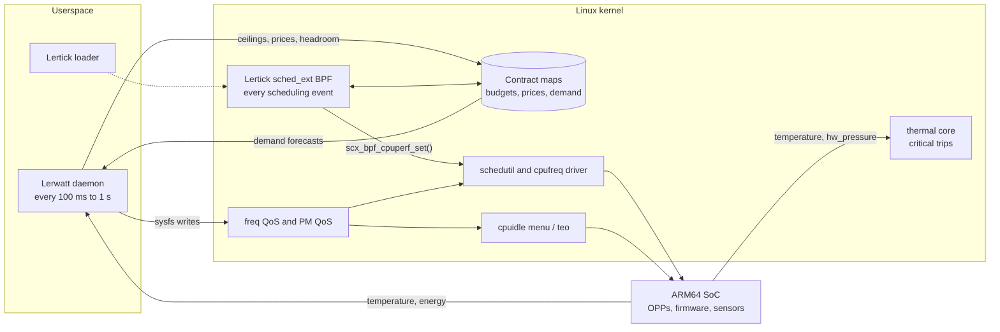

# Lerwatt — A Self-Learning Power Manager for Linux

Lerwatt is an experimental power manager for Linux. It is designed to learn CPU frequency limits, idle-depth constraints and thermal power budgets, and it cooperates with the [Lertick](https://github.com/Denny-Lin/lertick) sched_ext scheduler so that scheduling and power decisions stop working against each other.

[繁體中文](README.zh-TW.md) · [Design](docs/DESIGN.md) · [Simulation](docs/SIMULATION.md) · [Naming](docs/NAMING.md) · [Lertick](https://github.com/Denny-Lin/lertick)

## Current status

**Phase 1: rule-based controller and RK3588 simulator.** `lerwattd` (the controller) and `lerwatt-sim` (a simulated RK3588 board) build, and their unit, closed-loop and end-to-end tests pass. There is no learning yet, and nothing has run on real hardware.

The first platform is ARM64, modeled on an RK3588 board. The hardware layer reads and writes only standard Linux interfaces (cpufreq, cpuidle, thermal, hwmon), so `lerwattd` is not tied to ARM64; simulating another board means adding a platform description to `sim/`.

A feasibility study against the [Linux v7.3](https://github.com/torvalds/linux/tree/v7.3) source concluded that a two-controller prototype can be built on upstream interfaces without kernel patches, after four corrections to the original idea:

| Original idea | What Linux v7.3 actually does | Lerwatt design |
| --- | --- | --- |
| The power AI picks each CPU's frequency | When sched_ext runs every task, schedutil takes the BPF scheduler's `scx_bpf_cpuperf_set()` target as its input | Lertick supplies per-event performance demand in BPF; Lerwatt sets floors, ceilings, budgets and energy prices |
| The power AI picks voltages | The OPP core couples voltage to frequency; on SCMI and Qualcomm hardware DVFS, firmware owns voltage | Lerwatt selects operating points (frequencies) only and never touches regulators |
| The power AI picks idle states | menu/teo choose a state on every idle entry, within microseconds | Lerwatt sets latency limits and disables states; per-entry selection stays in the kernel |
| The power AI replaces thermal management | The thermal core handles critical trips; hardware throttling reports `hw_pressure` | Lerwatt replaces budget-allocation policy (for example IPA) and keeps every safety path |

A VM has no real cpufreq, cpuidle, thermal sensors, Energy Model or big.LITTLE cores. Until an RK3588 board is connected, `lerwatt-sim` provides those through the same kernel files a board exposes, so `lerwattd` runs unchanged on both and switches to real hardware by itself. Simulation results show that the control loop behaves; energy claims need the board and an external power meter. See [docs/SIMULATION.md](docs/SIMULATION.md) for exactly what is simulated.

An experimental learned policy (`lerwattd --policy mpc`) fits a two-node thermal model online and plans ceilings from it. In simulation it is safe and usually moves ceilings less often than the rule controller, but it serves less work under bursts, so the rule controller stays the default; see [docs/SIMULATION.md](docs/SIMULATION.md).

**A learned advantage is unproven.** Lerwatt must be measured against EAS + schedutil + the power-allocator thermal governor, and against [scx_lavd](https://github.com/sched-ext/scx/tree/main/scheds/rust/scx_lavd)'s power modes, before any claim is made.

## What Lerwatt decides, and what it never touches

| Decision | Owner | Interface in Linux v7.3 |
| --- | --- | --- |
| Per-event performance demand | Lertick (BPF) | `scx_bpf_cpuperf_set()` into schedutil |
| Task placement across big and LITTLE cores | Lertick (BPF) | sched_ext `select_cpu` and `dispatch` |
| Frequency floor and ceiling per cluster | Lerwatt | `scaling_min_freq` / `scaling_max_freq` (frequency QoS) |
| Power budget per cluster | Lerwatt | Ceilings derived from the Energy Model, as DTPM does |
| Idle depth | Lerwatt | `power/pm_qos_resume_latency_us`, `cpuidle/stateN/disable` |
| Energy-performance preference | Lerwatt | `energy_performance_preference` where the driver supports it |
| Thermal power budget | Lerwatt | Its own budget below the kernel's passive trips |
| Voltage | Nobody | OPP core and firmware only |
| Critical trips and hardware throttling | Kernel and hardware | Unchanged |

## Architecture



The two controllers run on separate timescales. Lertick acts on every scheduling event inside BPF. Lerwatt runs a 100 ms to 1 s control loop in userspace. They coordinate through prices rather than commands: Lerwatt raises a cluster's energy price when it exceeds its power or thermal budget, and Lertick includes that price in placement and performance decisions. See [docs/DESIGN.md](docs/DESIGN.md).

## Quick start

```sh
make            # build/lerwattd and build/lerwatt-sim
make test       # model unit tests and the 900 s closed-loop scenarios
make e2e        # simulator + controller through files, restore and crash recovery

# In the VM: a simulated board driven by the VM's real load, then the controller.
sudo build/lerwatt-sim --load procstat --cooling passive &
sudo build/lerwattd --telemetry lerwatt.jsonl

# On a real board: the same controller command. It finds /sys by itself.
sudo build/lerwattd --describe
```

| Path | Role |
| --- | --- |
| `include/lerwatt/contract.h` | Lerwatt <-> Lertick shared-map layout, the only shared ABI |
| `include/lerwatt/hal.h`, `src/hal_*.c` | Real-machine interface: discovery, sampling, writes, restore journal |
| `include/lerwatt/controller.h`, `src/controller.c` | Pure control law, no I/O |
| `src/lerwattd.c` | The daemon |
| `sim/` | The simulator: RK3588 data, physics, kernel-policy emulation, fake ABI, load sources |
| `tests/` | Model tests, closed-loop tests, end-to-end script |

## Roadmap

| Phase | Goal | Exit criterion |
| --- | --- | --- |
| 0 | Research and design | Feasibility study and this design (done) |
| 1 | Simulator and rule-based Lerwatt (in progress) | Done: simulator, controller, contract layout, tests. Next: run in the ARM64 VM with real load; Lertick publishes `lt_demand` and reads `lw_contract` |
| 2 | Hardware bring-up and baselines | RK3588 with a mainline kernel and `CONFIG_SCHED_CLASS_EXT=y`, energy measured externally, simulator calibrated, EEVDF + schedutil and scx_lavd baselines reproduced |
| 3 | Learned Lerwatt | Contextual bandit or MPC with a learned thermal and power model, inside a fixed safety envelope |
| 4 | Five-way evaluation | Baseline, each controller alone, both without cooperation, both with cooperation |
| 5 | Release and upstream discussion | Reproducible results; proposals only for interfaces that proved necessary |

## Safety

- Lerwatt writes only reversible settings: frequency floors and ceilings and resume-latency limits. It journals each original value before the first write, never loosens a limit it found in place, and restores everything on exit. After a crash, `lerwattd --restore` (or the next start) puts the values back.
- It never writes regulators, never changes trip temperatures and never disables a thermal zone.
- If Lerwatt stops, the kernel's own policies take over again. If Lertick stops, sched_ext falls back to the fair class and schedutil returns to fair-class utilization.

Run experiments on a board you can power-cycle, with a serial console.

## License

Code and documents use the [MIT License](LICENSE). Any BPF programs will be GPL-2.0-only, as Lertick's are.
