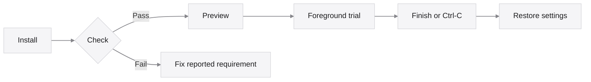
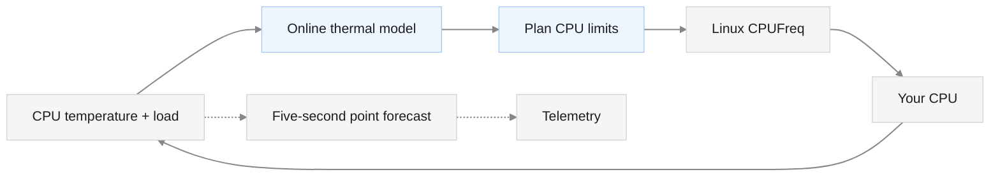

<h1 align="center">Lerwatt</h1>

<p align="center">AI-powered CPU power management. Built for your Linux.</p>

<p align="center">
  <a href="#get-started-on-ubuntu">Get started →</a> &nbsp;&nbsp;
  <a href="#how-it-works">Explore Lerwatt →</a> &nbsp;&nbsp;
  <a href="docs/USAGE.md">Read the guide →</a>
</p>

<p align="center">
  
</p>

<p align="center">
  <strong>Learns your machine.</strong> Builds a thermal model while it runs.<br />
  <strong>Plans ahead.</strong> Uses that model to choose predictive CPU ceilings.<br />
  <strong>Easy to try.</strong> Preview, run a finite trial, then restore your settings.
</p>

<p align="center">
  <a href="https://github.com/Denny-Lin/lerwatt/actions"></a>
  <a href="LICENSE"></a>
  
</p>

<br />

## Get started on Ubuntu

**Ubuntu 22.04 / 24.04 · native Linux · sudo access · no reboot**

Use a normal user account. The helper builds locally and asks for sudo when needed.

**1. Install the tools**

```sh
sudo apt-get update
sudo apt-get install --no-install-recommends git build-essential ca-certificates
git clone https://github.com/Denny-Lin/lerwatt.git
cd lerwatt
./deploy.sh install
```

**2. Check your machine and preview**

```sh
lerwatt check
lerwatt preview --duration 60
```

Continue after the hardware check passes. Preview leaves CPU control settings unchanged.

**3. Start a five-minute trial**

```sh
lerwatt run --duration 300
```

Press **Ctrl-C** to stop early. The helper waits for the controller and attempts to restore the journaled settings. Installation does not start a service or enable control at boot.



If recovery reports an error, keep the journal and tools, then retry with `lerwatt restore`. To remove Lerwatt after stopping the trial, run `lerwatt uninstall`.

You can also run directly from the checkout with `./deploy.sh check`, `./deploy.sh preview` and `./deploy.sh run`. See the [full guide](docs/USAGE.md#deploy-on-your-own-linux-hardware) for sensor selection, telemetry and other Linux distributions.

## How it works



The thermal model learns online; rule control covers warm-up and fallback. Models start fresh each launch, so preview does not pretrain a later run. Suitable learning observations usually take at least about 90 seconds.

Linux continues handling frequency transitions, idle-state selection and thermal protection. Learned planning sets CPU frequency ceilings; frequency floors and PM QoS idle-latency constraints currently use rules. The separate five-second point forecast is reported in telemetry; it does not drive control decisions. [Architecture and expansion →](docs/DESIGN.md)

## Tested Ubuntu versions

| Version | Software environments tested | Result |
| --- | --- | --- |
| **22.04.5 LTS** | ARM64 and x86_64 containers | Build, deployment tests, user/sudo install, restore and uninstall passed |
| **24.04.4 LTS** | ARM64 container | Same installation and deployment checks passed |
| **24.04.5 LTS** | x86_64 container; ARM64 VM | Deployment checks passed; ARM64 also passed model/control and end-to-end tests |

x86_64 execution used emulation. These validate software and installation; physical-board behavior remains to be measured. [Exact environments and compatibility →](docs/USAGE.md#compatibility)

**Hardware requirements:** usable CPUFreq controls and a CPU temperature input. Known multi-socket systems, offline CPUs in a discovered policy and some sensor/topology layouts are currently unsupported. `lerwatt check` reports missing capabilities. Keep kernel/firmware thermal protection enabled and check for competing power managers before a trial. [Requirements and limitations →](docs/USAGE.md#compatibility)

## Results so far

**Five-second forecast error: 1.47°C → 0.67°C mean absolute error.**

That is a **54.47% reduction** against Lerwatt's previous reference forecaster across six simulated daemon profiles, including fallback observations. A separate 192-run module study reduced mean forecast error by **28.95–29.51%**. The studies use different datasets and are reported separately.

Physical energy savings, battery life and throughput gains remain unmeasured. Predictive control remains experimental; its control trade-offs are evaluated separately from point-forecast accuracy.

**[Daemon results and raw records](results/point-model-observations/runtime/README.md)** · **[Module study](results/point-model-observations/README.md)** · **[Control comparisons](docs/SIMULATION.md#4-control-and-forecast-results)**

## Go further

| I want to… | Start here |
| --- | --- |
| Select a sensor, log telemetry or recover a trial | [Usage and recovery](docs/USAGE.md) |
| Understand the AI model and deterministic limits | [Design](docs/DESIGN.md) |
| Connect the optional Lertick scheduler | [Lertick integration](docs/USAGE.md#optional-lertick-integration) |
| Reproduce the experiments or contribute | [Development](docs/USAGE.md#development-and-reproduction) · [Simulator](docs/SIMULATION.md) |
| Share a hardware trial or report a problem | [Open an issue](https://github.com/Denny-Lin/lerwatt/issues) |

Lerwatt is **learning + watt**, pronounced **LER-watt**. [MIT licensed](LICENSE).
