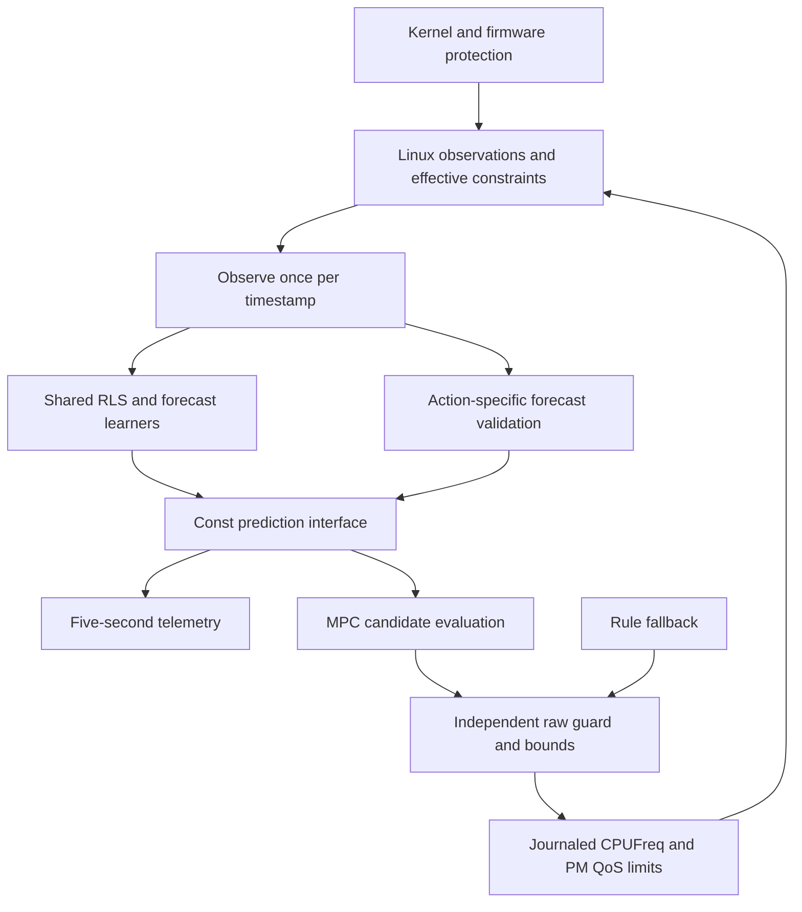

# Cooperative prediction for MPC

[Documentation](README.md) · [Design](DESIGN.md) · [Recorded validation](../results/cooperative-prediction/README.md)

`--policy mpc --prediction cooperative` enables a first, conservative Option B
implementation. MPC still selects frequency ceilings. The shared predictor
owns the existing RLS thermal model, delayed-feedback expert blend and temporal
LMS correction. There is no learned action-selection policy.

New service installations use nominal independent MPC and automatically discover
optional compatible Lertick information. Prediction selection is independent
of discovery: installing, starting or removing a peer never switches models.
Use `--prediction cooperative` separately to select cooperative prediction.
Saved prediction and explicit discovery opt-outs are preserved on upgrade.
Raw daemon CLI defaults remain rule/nominal. The finite-job regressions remain
recorded; no hardware energy benefit or accuracy gain from Lertick is established.
The [earlier activation evidence](../results/cooperative-activation/README.md)
records the superseded explicit-installation behavior. See
[automatic coordination](INTEGRATION.md) for current discovery behavior.

## Architecture and replacement boundary



The internal interface is `include/lerwatt/predict.h`, implemented in
`src/predict.c`. `lw_predictor_observe()` advances learning once per timestamp.
`lw_predictor_predict()` is const: enumerating candidates cannot train the
model, consume labels or advance a queue. All candidates use the observation's
model version. Point queries describe a five-second sensor forecast; control
queries describe the planner's peak-anchored temperature calculation under
candidate mean/peak power and frequency assumptions. These targets are not
interchangeable.

A backend supplies `observe`, `ready` and `predict` through versioned
`lw_prediction_ops`; bind it to a zero-initialized controller's predictor using
`lw_predictor_bind()`. Its context remains caller-owned and must outlive the
controller. The backend must do bounded computation without I/O or allocation
in callbacks and must not write controls. A test replacement runs through the
unchanged MPC; invalid/nonfinite predictions trigger fallback or reject the
candidate. A new backend still needs independent action, horizon and safety
validation. The interface cannot prove arbitrary callback code is safe or fast.

Queries carry candidate frequency, own/total mean power, peak/reference power,
package temperature, measured-peak anchor, horizon and capacity estimate.
Results carry nominal/central temperature, a planning upper estimate, validity,
correction reason, model version and power/energy/capacity predictions. The
joint planner consumes the backend's capacity and power estimates for its
existing work-first/power-tiebreak objective. It does not minimize physical
energy or enforce an application latency SLO.

Candidate power and energy are always predictions. EM estimates, calibrated
models and relative OPP proxies have distinct quality tags. Proxy tables set
`energy_valid=false`; their numeric scale must not be called physical joules.
EM horizon energy is a constant-power CPU estimate, excluding board/DRAM and
unmodeled leakage. It is not measured energy or a job-completion energy metric.

## Why the existing correction is restricted

The existing LMS learns five-second error on the actual policy trajectory.
It has no arbitrary future-action sequence as input. Passing its scalar
correction to every candidate frequency, or extrapolating it to the 120-second
hold, would be unsupported. The planner also anchors to a measured peak to
cancel absolute model bias; adding the residual would risk double correction.

Instead the same learned point output can tighten a control query only when:

- The horizon is exactly five seconds.
- Observed frequency and read-back maximum are unchanged and match the
  candidate. A missing maximum readback never establishes action support.
- Observations are at most 250 ms apart and the current one is fresh.
- Own/total power remain within 5% or 0.05 estimated units of the epoch anchor;
  candidate mean power is in that domain and peak/mean assumptions agree.
- The epoch covers at least 30 seconds and 100 matured labels. The actual
  issued point forecasts outperform their reference by a variability margin
  within this same epoch, and the existing temporal learner is active.
- The empirical allowance `2 * sqrt(epoch MSE) + 0.1 C` is at most 2 C.

The controller uses `max(original planning prediction, point + allowance)`.
It never adds the point residual to the original calculation or lowers that
calculation. The allowance and variability test are engineering heuristics,
not confidence bounds or guaranteed thermal coverage. Sampled stable frequency
does not establish continuous hardware residency or unchanged future load.

Action/power changes discard only control-validation labels and statistics.
They do not discard the existing thermal fit or point-forecast weights. This
preserves ordinary forecast learning while requiring new action-specific
evidence. There is one predictor, with extra validation state rather than a
second decision-making learner.

Unseen candidates and longer horizons use the original thermal prediction.
Unavailable/untrained models or invalid backend output retain rule fallback.
Missing necessary sensor data or I/O failure stops and restores through the
existing daemon path. The raw guard, initial user maximum, floor/ceiling
ordering, journal, systemd recovery and kernel/firmware trips remain in force.
Restoring original settings hands authority back to Linux; it does not promise
to maintain Lerwatt's lower soft target after exit.

## Use and roll back

On a supported, authorized Linux test machine, inspect first:

```sh
./deploy.sh preview --prediction cooperative
./deploy.sh run --policy mpc --prediction cooperative --duration 300
# Persistent opt-in, after validation on the target machine:
./deploy.sh install --policy mpc --prediction cooperative --period-ms 100
# Ordinary installation automatically discovers optional peers:
./deploy.sh install
# Prediction can be upgraded independently of peer availability:
./deploy.sh install --prediction cooperative
# Return to the original prediction path, preserving the selected policy:
./deploy.sh install --prediction nominal
```

Cooperative mode requires temporal forecasts, MPC and a 10–100 ms period.
Service configuration persists `prediction=nominal|cooperative`; old configs
without the key retain nominal mode on plain upgrade. Discovery flags never
change the private predictor. Existing
rule-policy or slow-period settings are not silently replaced: select MPC and
a supported period or explicitly use nominal prediction. Changing the mode
invalidates the old mode's checkpoint fingerprint. Only compatible long-term RLS parameters are
persisted; control-validation queues, recent history and forecast weights start
fresh. The built-in checkpoint rejects private replacement backends, which
need their own explicitly versioned persistence support.

`prediction_queries` and `prediction_corrections` count candidate evaluations,
not distinct actions, accuracy gains or joules saved. `prediction_reason`
describes the selected/current prediction; the epoch reset count and observed
maximum help explain rejection. `prediction_upper_c` is the planning value,
while `forecast_c` retains its expected-sensor meaning.

The Lertick ABI, ownership, freshness and lifecycle are unchanged. Models remain
private to Lerwatt; replacing this predictor does not require retraining or
restarting the scheduler. Peer absence, startup or restart never changes the
configured prediction mode. **Enabled does not mean applied:** every correction
must still pass action, horizon, freshness and reliability checks. Rejected
corrections use nominal MPC predictions; an unavailable/invalid required model
retains rule fallback. Neither deployment selection nor peer connectivity
bypasses these checks.

## Further work is evidence-gated

Wider action support needs a predictor conditioned on realized action/power
history and validated across candidate frequencies. Longer horizons need
separate error evaluation. Hardware residency, power-model calibration,
drift detection and deadline-bounded planning require further work. The daemon
remains a supervisory Linux loop, not a hard-real-time controller.

Keep the nominal path as the comparison and rollback. Promote neither a model
nor a default based on point MAE alone: require completed work, thermal safety,
measured energy, acceptable latency and bounded overhead.
