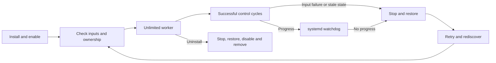

# Continuous operation

[← Lerwatt](../README.md) · [Hardware requirements and foreground trials](USAGE.md)

`./deploy.sh install` installs, enables and starts **`lerwatt.service`** on a running systemd system. The worker has no time limit, starts again after boot and retries after failures. `lerwatt uninstall` stops and disables the service, restores its journaled settings and removes the managed tools and unit.

This is continuous CPU policy control through existing Linux interfaces. CPUFreq drivers, CPUIdle, kernel thermal mitigation and firmware protection continue operating. The service lifecycle is implemented; physical-machine 24-hour or seven-day reliability is not established.

## Install and check

Use your normal user account in a trusted checkout, with the [build and hardware requirements](USAGE.md#compatibility) satisfied:

```sh
./deploy.sh install
lerwatt status
lerwatt logs
```

The helper builds as your normal user and requests sudo for installation and service operations. It checks hardware inputs and known competing policy services before replacing an existing managed service. Commands normally live under `/usr/local`; the unit is `/etc/systemd/system/lerwatt.service`. Installation requires no reboot.

`status` shows boot enablement and current status. A healthy worker reports `active (running)` after its first successful control cycle. An enabled service can still be failing or retrying, so inspect both status and logs. A failed activation is reported as an error; installed files alone are not reported as running control.

To update, update the trusted checkout and run `./deploy.sh install` again. The helper stops its owned worker, completes recovery, replaces files under the controller lock and starts with retained configuration. It refuses an unexpected unit or unreviewed drop-ins rather than overwriting another installation.

## Lifecycle and watchdog



| Setting | Behavior |
| --- | --- |
| `--duration 0` | No worker time limit. The finite `lerwatt run` trial is separate. |
| `Type=notify`, `NotifyAccess=main` | The actual control process reports readiness after a successful cycle. |
| `WatchdogSec=30s` | PID 1 independently monitors progress. Heartbeats come from successful control cycles, not a separate thread that could conceal a stuck loop. |
| `WatchdogSignal=SIGTERM`, `TimeoutAbortSec=15s`, `TimeoutStopSec=15s` | Bound both watchdog abort and ordinary stop waits, then force termination where the kernel permits it. |
| `KillMode=control-group` | Stop the service's remaining processes before post-stop recovery. |
| `ExecStopPost=… service-restore` | Retry journal restoration after the worker stops, including an abnormal exit. |
| `Restart=always`, `RestartSec=10s` | Restart an exited worker after recovery. Manual `stop` and uninstall do not trigger automatic restart. |
| `StartLimitIntervalSec=0` | Keep retrying instead of permanently exhausting the start-rate allowance. |

Normal shutdown restores controls before optional model-file I/O; the post-stop command makes another restoration attempt. Failed recovery retains the journal, and a replacement worker refuses new control until previous settings can be restored. Blocked kernel operations or arbitrary kernel failures can still prevent timely termination or recovery. The watchdog is not a replacement for thermal protection.

The unit deliberately has **no `RuntimeDirectory=lerwatt` cleanup**: `/run/lerwatt/restore.journal` and the persistent lock inode must survive service-process stops. Reboot normally resets kernel settings and `/run`; learned state lives separately under `/var/lib`.

## Input changes and failures

| Event | Response |
| --- | --- |
| Missing, malformed or faulted required sensor | Stop control, restore and retry. A returning valid sensor can allow the next worker to start. |
| Sampling or actuation failure | Stop and restore; retain recovery data if that fails. |
| Worker stops making progress | systemd expires its watchdog, terminates the worker and runs post-stop recovery before restarting. |
| Detected suspend/resume or stale observations | Stop instead of using old timing/history; the new worker rediscovers the machine. |
| Online CPU mask changes | Stop and rediscover. Unsupported resulting topology remains a reported startup failure. |
| Incompatible or invalid checkpoint | Keep fresh state and learn again; control does not depend on loading the file. |

The existing bounds on CPU IDs, policies and temperature inputs still apply. Restarting discovery is not universal hotplug support: a policy containing an offline CPU remains unsupported. A sensor returning an old but plausible number cannot reliably be distinguished from steady temperature. See [compatibility](USAGE.md#compatibility).

## Configuration

The service reads **`/etc/lerwatt/lerwatt.conf`**, a strict data file:

```text
policy=mpc
period_ms=100
soft_limit_c=auto
temperature_sensor=auto
```

| Key | Accepted value |
| --- | --- |
| `policy` | `mpc` or `rule` |
| `period_ms` | Integer `10` through `10000` |
| `soft_limit_c` | `auto`, or a positive Celsius value accepted by the daemon |
| `temperature_sensor` | `auto`, or an actual CPU/package sensor input under `/sys/` |

Use one assignment per line, no spaces around `=`, shell syntax or inline comments. Blank lines and lines starting with `#` are accepted. The file is parsed as data, never sourced as a shell script. Unknown keys and invalid values prevent startup.

The directory is root-owned mode `0700`; the file is mode `0600`. Symlinks, hardlinks and unsafe ownership/permissions are rejected. A system install also requires a protected root-owned prefix. Use `/usr/local` or `/opt/lerwatt`; spaces, `%` and `$` are supported, while quotes and backslashes are rejected early for systemd executable-path compatibility. Tools-only staging retains ordinary file-path support.

You can select settings at installation:

```sh
./deploy.sh install --policy mpc --period-ms 100 --soft-limit 75 \
  --temperature-sensor /sys/class/hwmon/hwmon3/temp2_input
```

That sensor path is an example: use the real CPU/package sensor on your machine. Existing settings remain when no override is supplied. To edit later:

```sh
sudoedit /etc/lerwatt/lerwatt.conf
lerwatt restart
lerwatt status
```

The service fixes the real-machine root, disables optional Lertick contract publication and enables unlimited supervised operation. `--duration` and `--telemetry` are foreground-trial options, not persistent-install overrides. Service diagnostics use journald, with unit-level message rate limits; no per-period JSON file grows by default.

## Learned thermal state

**`/var/lib/lerwatt/model.state`** lives in an owned `0700` directory and has mode `0600`. Trained thermal parameters are saved approximately every five minutes and on a clean stop. An abrupt termination can lose the newest unsaved learning while retaining an earlier useful checkpoint.

The checkpoint preserves thermal coefficients, recursive-fit covariance, sample counts and long-term hot-spot gain. It does **not** restore CPU limits, integrators, filter history, clock values, recent peaks, incomplete fitting intervals or pending point-forecast labels. Point-forecast model state is not checkpointed in this version.

A new worker takes a fresh observation and initializes its controller before importing compatible parameters. No trained valid model means saving is a no-op; it does not erase a useful existing checkpoint.

The file has a format version, bounded records, checksum and finite/range checks. A fingerprint binds it to machine identity, policy/CPU layout, frequency/power data, drivers, sensor paths and controller settings. A mismatch, unknown version, corruption or age over **30 days** causes fresh-model fallback. This cannot detect every change to cooling conditions or firmware.

Writes use a private temporary file, file synchronization, atomic rename and directory synchronization. Symlinks, hardlinks, FIFOs, unsafe directories and unrelated existing files are refused. A corrupt or unknown existing file is retained and not overwritten automatically. Review the logged error and remove only a confirmed unusable model file to allow new checkpoints. The model file is separate from the recovery journal and must never replace it.

## Control ownership

One active Lerwatt controller or restoration/maintenance operation owns its runtime lock. The service, raw daemon and foreground trial therefore cannot normally write concurrently through Lerwatt. An active service causes a separate `run` or `restore` to fail rather than take over. Read-only preview remains available.

Before startup, the helper checks these known policy services:

```text
tlp.service
auto-cpufreq.service
tuned.service
power-profiles-daemon.service
```

An active manager causes a reported conflict. Choose the policy owner deliberately using that manager's normal configuration. Lerwatt never automatically stops, disables or masks those managers, and does not stop `thermald`.

These are **startup checks, not complete dynamic arbitration**. They do not detect every custom writer, prevent another manager starting later or reconcile concurrent writes to shared CPUFreq/PM QoS controls. Keep one userspace owner for overlapping knobs. Kernel/firmware thermal constraints remain independent; a restore snapshot does not encode another manager's later intent.

## Manage and uninstall

```sh
lerwatt status
lerwatt logs
lerwatt stop
lerwatt start
lerwatt restart
```

`logs` shows the latest 100 journal messages. For a live stream:

```sh
sudo journalctl -u lerwatt.service -f
```

A manual stop restores controls and leaves boot enablement intact. Start resumes without reinstalling. Restart stops/restores the old worker before a replacement starts; `Restart=always` does not override an intentional systemd stop.

To remove persistent control:

```sh
lerwatt uninstall
```

Uninstall stops and disables the owned service, attempts restoration under the shared lock, removes managed tools/unit and reloads systemd. Configuration, model and recovery data are retained. If restoration fails, the service remains stopped/disabled and tools, unit and journal remain for repair; removal is not reported as successful. Preserve them, inspect the error and retry after resolving it.

## Other init systems and staging

Persistent installation requires running systemd. On another Linux init system, install commands only:

```sh
./deploy.sh install-tools
```

This does not provide automatic startup, systemd watchdog recovery or supervised continuous operation. Arrange equivalent supervision and post-stop recovery with your service manager. [Foreground trials](USAGE.md#run-on-your-linux-machine) remain available.

`DESTDIR` stages command files without sudo, daemon execution, systemd contact or host-kernel changes. Staging is not persistent-service activation.

## Validation and limits

On Ubuntu **24.04.5 ARM64**, with **systemd 255** in a VM, an explicit PID 1 integration test passed: install/boot enablement, unlimited ready worker, `SIGSTOP` watchdog termination, restoration before automatic restart, sensor failure/recovery, and uninstall/disable/removal. The test used a uniquely named unit and temporary file-based CPU controls. It shortened watchdog/restart timeouts for the test and never activated the production hardware-control unit or rebooted the shared VM.

The [integration script](../tests/test_service_systemd.py) requires an explicit VM-only invocation:

```sh
sudo python3 tests/test_service_systemd.py --allow-systemd-test \
  --daemon build/lerwattd-standalone
```

Portable and fixture tests also cover checkpoint rejection, notifications, worker failures, ownership checks and helper installation/removal. These results establish software lifecycle behavior in their recorded environments. They are not one-hour, 24-hour or seven-day physical-hardware measurements of temperature, energy, performance or reliability.

References: systemd's [restart/watchdog and stop hooks](https://www.freedesktop.org/software/systemd/man/latest/systemd.service.html), [notification protocol](https://www.freedesktop.org/software/systemd/man/latest/sd_notify.html) and [unit lifecycle](https://www.freedesktop.org/software/systemd/man/latest/systemd.unit.html).
